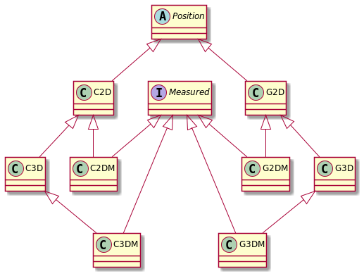

# Manual

This manual describes the geometry model and the main APIs of `geolatte-geom`. If you are new to the library, start
with the [Quick start](quick-start.md).

The code examples assume these imports:

```java
import org.geolatte.geom.*;
import org.geolatte.geom.crs.*;

import static org.geolatte.geom.builder.DSL.*;
import static org.geolatte.geom.crs.CoordinateReferenceSystems.*;
```

Contents:

1. [Design principles](#design-principles)
2. [Positions](#positions)
3. [Coordinate Reference Systems](#coordinate-reference-systems)
4. [Geometries](#geometries)
5. [Creating geometries](#creating-geometries)
6. [Bounding boxes](#bounding-boxes)
7. [Geometry operations](#geometry-operations)
8. [Coordinate transformations](#coordinate-transformations)
9. [Encoding and decoding](#encoding-and-decoding)
10. [JTS interop](#jts-interop)
11. [Features](#features)
12. [Space-filling curves](#space-filling-curves)
13. [Geometry generators](#geometry-generators)

## Design principles

- **Immutable.** Positions, geometries, bounding boxes and coordinate reference systems cannot be changed after
  creation. Every operation returns a new object.
- **Typed by coordinate reference system.** Every geometry has a `CoordinateReferenceSystem`, and its Java type carries
  the `Position` type of that system. A `Point<G2D>` (longitude/latitude) and a `Point<C2D>` (projected x/y) are
  different types, so the compiler stops you from mixing them.
- **Operations are separate from the model.** Spatial analysis lives in operation classes, not in methods on
  `Geometry`. This allows different implementations for projected and geographic coordinates (see
  [Geometry operations](#geometry-operations)).
- **Based on the standards.** The model follows the
  [Simple Feature Access (1.2.1) specification](https://portal.ogc.org/files/?artifact_id=25355) and ISO 19107.

## Positions

A `Position` is a tuple of coordinates that specify a position relative to a coordinate reference system. It corresponds
to the concept of **direct position** in the Simple Feature and ISO-19107 specifications.

The coordinate space can be 2-, 3- or 4-dimensional. The first two dimensions are used to specify a point on the earth's
surface. The third dimension usually represents altitude or elevation, and the fourth a measurement.

There are two major types of 2D coordinate reference systems. `GeographicCoordinateReferenceSystem`s specify points on
the earth's surface using geodetic coordinates (longitude and latitude). `ProjectedCoordinateReferenceSystem`s use
cartesian coordinates (x and y) on a projected plane.

From these 2D base systems we can construct higher-dimensional systems by adding a
`VerticalCoordinateReferenceSystem` for elevation and/or a `LinearCoordinateReferenceSystem` for a (user-defined)
measurement (see [Coordinate Reference Systems](#coordinate-reference-systems)).

Consequently, the instantiable (2D) types of `Position` are `G2D` (geodetic coordinates) and `C2D` (cartesian
coordinates) in a geographic, resp. projected coordinate reference system. Subtypes of `G2D` for the higher dimensional
coordinate reference systems are `G3D` (position + elevation), `G2DM` (position + measure), and `G3DM`. For `C2D` a
parallel hierarchy exists. This leads to the following class hierarchy.



### Creating positions

The DSL has a short factory method for each position type:

| Method                 | Position type |
|------------------------|---------------|
| `g(lon, lat)`          | `G2D`         |
| `g(lon, lat, h)`       | `G3D`         |
| `gM(lon, lat, m)`      | `G2DM`        |
| `g(lon, lat, h, m)`    | `G3DM`        |
| `c(x, y)`              | `C2D`         |
| `c(x, y, z)`           | `C3D`         |
| `cM(x, y, m)`          | `C2DM`        |
| `c(x, y, z, m)`        | `C3DM`        |

When the position type is only known at run time, use `Positions.mkPosition`, which picks the position type of the
coordinate reference system:

```java
G2D pos = Positions.mkPosition(WGS84, 4.35, 50.85);
```

### Empty positions

A position created without coordinates (e.g. `new G2D()`) is *empty*: `isEmpty()` returns `true` and all its
coordinates are `Double.NaN`. Empty positions are used for empty bounding boxes and similar "no value" cases.

## Coordinate Reference Systems

For many operations a `CoordinateReferenceSystem` is required. The most important ways to create or get hold of a
`CoordinateReferenceSystem` instance are:

- Using one of the statically declared systems in the `CoordinateReferenceSystems` class
- Finding the system by its [EPSG](https://epsg.org/home.html) code in the `CrsRegistry`
- Building one yourself with the factory methods in `CoordinateReferenceSystems`

### Predefined systems

`CoordinateReferenceSystems` declares:

| Constant              | Position type | Description                                                   |
|-----------------------|---------------|---------------------------------------------------------------|
| `WGS84`               | `G2D`         | WGS 84 longitude/latitude (EPSG:4326)                         |
| `ETRS89`              | `G2D`         | ETRS89 longitude/latitude (EPSG:4258)                         |
| `WEB_MERCATOR`        | `C2D`         | WGS 84 / Pseudo-Mercator (EPSG:3857)                          |
| `PROJECTED_2D_METER`  | `C2D`         | A generic projected system in meters, without an EPSG code    |
| `PROJECTED_2DM_METER` | `C2DM`        | `PROJECTED_2D_METER` with a measure axis                      |
| `PROJECTED_3D_METER`  | `C3D`         | `PROJECTED_2D_METER` with a vertical axis                     |
| `PROJECTED_3DM_METER` | `C3DM`        | `PROJECTED_2D_METER` with a vertical and a measure axis       |

The generic `PROJECTED_*` systems have SRID -1. They are what you get when you decode WKT or WKB without an SRID, and
they are convenient for working with plain cartesian coordinates.

### The CRS registry

`CrsRegistry` holds the definitions of more than 8000 coordinate reference systems from the EPSG database, loaded from
the `spatial_ref_sys.txt` resource included in the library.

```java
// typed lookups
ProjectedCoordinateReferenceSystem lambert72 = CrsRegistry.getProjectedCoordinateReferenceSystemForEPSG(31370);
Geographic2DCoordinateReferenceSystem etrs89 = CrsRegistry.getGeographicCoordinateReferenceSystemForEPSG(4258);

// untyped lookup, with a fallback for unknown codes (pass null to get null instead)
CoordinateReferenceSystem<?> crs = CrsRegistry.getCoordinateReferenceSystemForEPSG(31370, WGS84);

boolean known = CrsRegistry.hasCoordinateReferenceSystemForEPSG(31370);
```

Coordinate reference systems are identified by a `CrsId`, which combines an authority and a code (`CrsId.valueOf(4326)`
is `EPSG:4326`). You can register your own systems with `CrsRegistry.registerCoordinateReferenceSystem(crs)`, after
which they can be looked up like the built-in ones.

### Adding vertical and measure axes

You can create higher-dimensional coordinate reference systems by adding a vertical or linear system. The result is a
`CompoundCoordinateReferenceSystem`.

```java
CoordinateReferenceSystem<C2D> crs2D = CrsRegistry.getProjectedCoordinateReferenceSystemForEPSG(31370);
CoordinateReferenceSystem<C3D> crsZ = crs2D.addVerticalSystem(LinearUnit.METER, C3D.class);
CoordinateReferenceSystem<C3DM> crsZM = crsZ.addLinearSystem(LinearUnit.METER, C3DM.class);
```

When you only know the required dimensions at run time, `CoordinateReferenceSystems.adjustTo(crs, hasZ, hasM)` adds or
removes the vertical and measure axes as needed. `hasVerticalAxis(crs)` and `hasMeasureAxis(crs)` tell you which axes a
system has.

### Building systems yourself

The factory methods `mkProjected`, `mkGeographic`, `mkVertical` and `mkLinear` in `CoordinateReferenceSystems` create
simple systems with a given unit (and optionally a `CrsId`), and `combine` builds compound systems from them.

To create a system from a Well-Known Text definition, use the `CrsWktDecoder`. It reads the WKT format for spatial
reference systems defined in OGC Simple Features and ISO/IEC 13249-3 (SQL/MM Spatial, subclause 14.1.9), which is
also the format of the `srtext` column in the Postgis `spatial_ref_sys` table. The second argument is the SRID to
assign to the decoded system.

```java
import org.geolatte.geom.codec.CrsWktDecoder;

String wktDefinition = """
        PROJCS["Belge 1972 / Belgian Lambert 72",
            GEOGCS["Belge 1972",
                DATUM["Reseau_National_Belge_1972",
                    SPHEROID["International 1924", 6378388, 297]],
                PRIMEM["Greenwich", 0],
                UNIT["degree", 0.0174532925199433]],
            PROJECTION["Lambert_Conformal_Conic_2SP"],
            PARAMETER["standard_parallel_1", 51.16666723333333],
            PARAMETER["standard_parallel_2", 49.8333339],
            PARAMETER["latitude_of_origin", 90],
            PARAMETER["central_meridian", 4.367486666666666],
            PARAMETER["false_easting", 150000.013],
            PARAMETER["false_northing", 5400088.438],
            UNIT["metre", 1]]
        """;

CoordinateReferenceSystem<?> fromWkt = new CrsWktDecoder().decode(wktDefinition, 31370);
// a ProjectedCoordinateReferenceSystem with CrsId EPSG:31370 and position type C2D
```

The decoder also accepts the common extensions to this grammar that are used in the EPSG definitions: `AUTHORITY`,
`AXIS`, and `TOWGS84` in the `DATUM`. Include the `TOWGS84` parameters if you need
[datum shifts](#coordinate-transformations) for the system. A decoded system is not registered automatically; call
`CrsRegistry.registerCoordinateReferenceSystem(crs)` if you want to look it up by its code later.

## Geometries

A `Geometry` is a topologically closed set (in the mathematical sense) of `Position`s. The instantiable `Geometry`
subclasses all specify this set using one or more boundaries. The boundaries in turn are specified by interpolation
between consecutive elements in a list of `Position`s. These `Position`s are called the _vertices_ of the
`Geometry`.

A distinctive feature of this library is that the `Geometry` class is parameterized by `Position` type. This means
that e.g. a `Point<C2D>` is a different type than `Point<G2D>`. This ensures that it is always explicit what the
coordinates mean (projected or geodetic), and what types of operation make sense. E.g. the Euclidean distance on the
plane works for projected coordinates, but makes no sense for geodetic coordinates.

The instantiable subclasses of `Geometry` are:

- `Point`: a single position
- `LineString`: a 1-dimensional curve specified by linear interpolation between its vertices
- `LinearRing`: a closed `LineString`, used for the boundaries of polygons
- `Polygon`: a 2-dimensional space enclosed by an outer `LinearRing`, minus the space enclosed by any inner
  `LinearRing`s
- `MultiPoint`: a collection of `Point`s
- `MultiLineString`: a collection of `LineString`s
- `MultiPolygon`: a collection of `Polygon`s
- `GeometryCollection`: a collection of `Geometry`s

### Common properties

Every geometry offers:

| Method                                        | Returns                                                         |
|-----------------------------------------------|-----------------------------------------------------------------|
| `getCoordinateReferenceSystem()`, `getSRID()` | the coordinate reference system and its EPSG code               |
| `getGeometryType()`                           | the `GeometryType` (`POINT`, `LINESTRING`, …)                   |
| `getDimension()`                              | the topological dimension (0 for points, 1 for lines, 2 for areas) |
| `getCoordinateDimension()`, `hasZ()`, `hasM()` | the number of coordinates per position, and which axes exist   |
| `isEmpty()`                                   | whether the geometry has no positions                           |
| `getNumPositions()`, `getPositionN(i)`, `getPositions()` | the vertices                                         |
| `getBoundingBox()`                            | the bounding box (see [Bounding boxes](#bounding-boxes))       |
| `getPositionClass()`                          | the `Position` type                                             |

The subclasses add type-specific accessors:

- `Point`: `getPosition()`
- `LineString`: `getStartPosition()`, `getEndPosition()`, `isClosed()`, `isRing()`
- `Polygon`: `getExteriorRing()`, `getNumInteriorRing()`, `getInteriorRingN(i)`
- `MultiPoint`, `MultiLineString`, `MultiPolygon`, `GeometryCollection`: `getNumGeometries()`, `getGeometryN(i)`,
  `components()`, and they are `Iterable` over their components

### Empty geometries

Every geometry type has an empty variant (`POINT EMPTY`, `LINESTRING EMPTY`, …), created with the `Geometries.mkEmpty*`
methods. Accessors that read a specific vertex, such as `Point.getPosition()` or `LineString.getStartPosition()`,
throw an `IndexOutOfBoundsException` on an empty geometry, so check `isEmpty()` first. `Polygon.getExteriorRing()`
returns an empty ring for an empty polygon.

### Casting and changing the coordinate reference system

Decoders and other generic code often return a `Geometry<?>`. Use `as(Class)` to cast it to the expected position type;
it throws a `ClassCastException` if the position type doesn't match.

```java
Geometry<?> decoded = Wkt.fromWkt("SRID=4326;POINT(4.35 50.85)");
Geometry<G2D> geometry = decoded.as(G2D.class);
```

`toCrs(crs, defaultValue)` and the static `Geometry.forceToCrs(geometry, crs, defaultValue)` return a copy of a
geometry with a different coordinate reference system, **without transforming the coordinates**. Use them to
relabel a geometry, or to add or drop coordinate axes; new axes are filled with the default value. To actually
convert coordinates between systems, see [Coordinate transformations](#coordinate-transformations).

```java
Point<G2D> pnt = point(WGS84, g(4.35, 50.85));
CoordinateReferenceSystem<G3D> wgs84Z = WGS84.addVerticalSystem(LinearUnit.METER, G3D.class);
Geometry<G3D> pntZ = Geometry.forceToCrs(pnt, wgs84Z, 10.0);
// SRID=4326;POINT(4.35 50.85 10)
```

### Equality

`Geometry.equals()` returns `true` when two geometries have the same position type, the same coordinate reference
system, the same geometry type and exactly the same coordinates. Two empty geometries with the same position type are
always equal.

For other notions of equality, use a `GeometryEquality` implementation:

- `GeometryPositionEquality` compares geometries position by position, using a pluggable `PositionEquality`
  (`ExactPositionEquality` or `WithinTolerancePositionEquality`)
- `ApproximateGeometryEquality` is a shorthand for a `GeometryPositionEquality` that compares coordinates within a
  given tolerance

```java
GeometryEquality approx = new ApproximateGeometryEquality(0.01);
approx.equals(point(WGS84, g(1, 1)), point(WGS84, g(1.001, 1)));   // true
point(WGS84, g(1, 1)).equals(point(WGS84, g(1.001, 1)));            // false
```

### Visitors

`Geometry.accept(GeometryVisitor)` walks a geometry's structure. A `GeometryVisitor` has a `visit` method for `Point`,
`LineString`, `Polygon` and geometry collections. To process individual vertices, call `accept(PositionVisitor)` on the
geometry's `PositionSequence`.

## Creating geometries

### The DSL

The `DSL` class is the most concise way to create geometries. Pass the coordinate reference system to the outer method;
nested elements (rings, the parts of multi-geometries) are written without it.

```java
Point<G2D> pnt = point(WGS84, g(4.33, 53.21));

LineString<G2D> line = linestring(WGS84, g(4.43, 53.21), g(4.44, 53.20), g(4.45, 53.19));

// a polygon with a hole
Polygon<C2D> withHole = polygon(PROJECTED_2D_METER,
        ring(c(0, 0), c(10, 0), c(10, 10), c(0, 10), c(0, 0)),
        ring(c(2, 2), c(4, 2), c(4, 4), c(2, 4), c(2, 2)));

MultiPoint<G2D> points = multipoint(WGS84, g(1, 1), g(2, 2));

MultiLineString<G2D> lines = multilinestring(WGS84,
        linestring(g(1, 1), g(2, 2)),
        linestring(g(3, 3), g(4, 4)));

MultiPolygon<C2D> polygons = multipolygon(PROJECTED_2D_METER,
        polygon(ring(c(0, 0), c(1, 0), c(1, 1), c(0, 0))),
        polygon(ring(c(5, 5), c(6, 5), c(6, 6), c(5, 5))));

GeometryCollection<G2D> collection = geometrycollection(WGS84,
        point(g(1, 1)),
        linestring(g(1, 1), g(2, 2)));
```

`point(crs)`, `linestring(crs)`, `multipoint(crs)` etc. without positions create empty geometries.

### The `Geometries` factory

When the DSL doesn't fit, for instance when the parts are created separately, use the static `mk*` methods of
`Geometries`: `mkPoint`, `mkLineString`, `mkLinearRing`, `mkPolygon`, `mkMultiPoint`, `mkMultiLineString`,
`mkMultiPolygon`, `mkGeometryCollection`, and `mkEmpty*` for each type. `mkGeometry(Class, parts)` creates a geometry
whose type is only known at run time.

### Position sequences

To build geometries from your own data, collect the coordinates in a `PositionSequence` with a
`PositionSequenceBuilder`. Use `fixedSized(n, positionClass)` when you know the number of positions in advance, and
`variableSized(positionClass)` otherwise.

```java
PositionSequence<C2D> seq = PositionSequenceBuilders.variableSized(C2D.class)
        .add(0, 0)
        .add(1, 1)
        .toPositionSequence();
LineString<C2D> fromSeq = Geometries.mkLineString(seq, PROJECTED_2D_METER);
```

## Bounding boxes

`Geometry.getBoundingBox()` returns a `Box`: the smallest axis-aligned box that contains all positions of the
geometry, in **all** its coordinate dimensions. A `Box` supports `union`, `intersect`, `contains`, `intersects` and
`within`. An empty geometry has an empty box (`isEmpty()` returns `true`, the corner positions are empty).

```java
Polygon<C2D> square = polygon(PROJECTED_2D_METER, ring(c(0, 0), c(10, 0), c(10, 10), c(0, 10), c(0, 0)));
Box<C2D> box = square.getBoundingBox();
// lower-left (0, 0), upper-right (10, 10)
```

> **`Box` or `Envelope`?** The library also has an older `Envelope` class, returned by `Geometry.getEnvelope()`.
> `Envelope` is a 2D (XY) envelope: it only takes the first two coordinates into account. For geometries with Z or M
> coordinates, the Z and M values of an `Envelope` are meaningless, and `contains`/`intersects` ignore them. Use `Box`
> unless an API requires an `Envelope`, as the JTS envelope conversion and the
> [space-filling curves](#space-filling-curves) do.

Neither class handles bounding boxes that cross the antimeridian.

## Geometry operations

The [Simple Feature specification](https://portal.ogc.org/files/?artifact_id=25355) specifies a number of spatial query
and analysis operations as methods on the `Geometry` classes. From a design standpoint, declaring these operations as
methods has several drawbacks:

- Some operations need very different implementations in case of projected vs. geographic coordinate reference systems.
- It precludes the possibility of having alternative implementations for the operations with perhaps very different
  performance or correctness properties

For these reasons the spatial operations are separated into their own classes. Currently, two types are supported:

- `ProjectedGeometryOperations` : operations on projected (planar) geometries (i.e. `C2D` and subtypes)
- `MeasureGeometryOperations` : operations specific to projected (planar) geometries with a Measure (i.e. `C2DM`,
  `C3DM`)

At present there is no support for operations on geometries in a `GeographicCoordinateReferenceSystem`. To analyse
geographic geometries, transform them to a suitable projected system first.

You get an implementation from the `GeometryOperations` factory class. Currently there are only default
implementations available. The `ProjectedGeometryOperations` implementation delegates to
[JTS](#jts-interop).

### Operations on projected geometries

| Kind          | Methods                                                                                     |
|---------------|---------------------------------------------------------------------------------------------|
| Predicates    | `intersects`, `touches`, `crosses`, `contains`, `overlaps`, `relates` (with a DE-9IM pattern), `isSimple` |
| Set operations | `intersection`, `union`, `difference`, `symmetricDifference`                               |
| Measurements  | `distance`, `length` (linear geometries), `area` (polygonal geometries)                     |
| Constructions | `buffer`, `convexHull`, `centroid` (polygonal geometries), `boundary`, `reverse`            |

`length` accepts only linear geometries (`LineString`, `MultiLineString`), and `area` and `centroid` only polygonal
ones (`Polygon`, `MultiPolygon`); this is enforced at compile time.

```java
ProjectedGeometryOperations pgo = GeometryOperations.projectedGeometryOperations();

Polygon<C2D> sq = polygon(PROJECTED_2D_METER, ring(c(0, 0), c(10, 0), c(10, 10), c(0, 10), c(0, 0)));
Point<C2D> center = point(PROJECTED_2D_METER, c(5, 5));

boolean inside = pgo.contains(sq, center);              // true
boolean viaMatrix = pgo.relates(sq, center, "T*****FF*"); // true: the DE-9IM pattern for "contains"
double area = pgo.area(sq);                              // 100.0
Point<C2D> centroid = pgo.centroid(sq);                  // POINT(5 5)
Geometry<C2D> buffered = pgo.buffer(center, 1.0);        // a polygon approximating a circle
```

### Operations on measured geometries

Measured geometries carry an M value at each vertex, for instance a distance along a road (linear referencing).

| Method                                             | Result                                                                  |
|----------------------------------------------------|-------------------------------------------------------------------------|
| `locateAlong(geometry, m)`                         | the points with measure `m`                                             |
| `locateBetween(geometry, m1, m2)`                  | the parts with measures between `m1` and `m2`                           |
| `measureAt(geometry, position, tolerance)`         | the measure at a position on (or within tolerance of) the geometry      |
| `measureOnLength(geometry, mClass, keepBeginMeasure)` | a copy of a geometry with measures set to the length along the geometry |
| `minimumMeasure(geometry)`, `maximumMeasure(geometry)` | the smallest and largest measure                                    |

```java
MeasureGeometryOperations mgo = GeometryOperations.measureGeometryOperations();
LineString<C2DM> road = linestring(PROJECTED_2DM_METER, cM(0, 0, 0), cM(10, 0, 1), cM(20, 0, 2));

Geometry<C2DM> section = mgo.locateBetween(road, 1.5, 1.8);  // MULTILINESTRINGM((15 0 1.5,18 0 1.8))
Geometry<C2DM> atM = mgo.locateAlong(road, 1.5);             // MULTIPOINTM((15 0 1.5))
double m = mgo.measureAt(road, new C2D(15, 0), 0.01);        // 1.5

LineString<C2D> unmeasured = linestring(PROJECTED_2D_METER, c(0, 0), c(10, 0), c(20, 0));
Geometry<C2DM> measured = mgo.measureOnLength(unmeasured, C2DM.class, false);
// LINESTRINGM(0 0 0,10 0 10,20 0 20)
```

## Coordinate transformations

`TransformOperations.from(source, target)` creates a `TransformOperation` that converts positions from one coordinate
reference system to another. Apply it to positions with `forward` (and `reverse` for the other direction), or to whole
geometries with a `TransformVisitor`.

```java
import org.geolatte.geom.crs.trans.*;

CoordinateReferenceSystem<C2D> lambert72 = CrsRegistry.getProjectedCoordinateReferenceSystemForEPSG(31370);
TransformOperation<G2D, C2D> op = TransformOperations.from(WGS84, lambert72);

// a single position
C2D projected = op.forward(g(4.35, 50.85));

// a whole geometry
Point<G2D> brussels = point(WGS84, g(4.35, 50.85));
TransformVisitor<G2D, C2D> visitor = new TransformVisitor<>(op);
brussels.accept(visitor);
Geometry<C2D> transformed = visitor.getTransformed();
// SRID=31370;POINT(148679.448... 171066.810...)
```

Supported transformations:

- **Map projections:** Lambert Conformal Conic (2SP), as used by e.g. Belgian Lambert 72 (EPSG:31370) and
  Lambert-93 (EPSG:2154), and Pseudo-Mercator (EPSG:3857, `WEB_MERCATOR`).
- **Datum shifts:** between geographic systems, using the 7-parameter `TOWGS84` (position vector) values from the
  system definitions. Both systems must have `TOWGS84` parameters, or be WGS 84.
- Vertical and measure axes are carried over unchanged.

Other projections are not supported. Creating a transformation to or from a system with any other projection (for
example the UTM zones, which use Transverse Mercator) with `TransformOperations.from` or
`CoordinateOperations.transform` throws an `UnsupportedTransformException`.

> **Warning.** Systems declaring the `Mercator_1SP` projection, such as World Mercator (EPSG:3395), are computed with
> the spherical Pseudo-Mercator formulas, which is only correct for EPSG:3857.

## Encoding and decoding

### WKT and WKB

The `Wkt` and `Wkb` classes convert geometries to and from Well-Known Text and Well-Known Binary.

```java
import org.geolatte.geom.codec.*;

Point<G2D> pnt = point(WGS84, g(4.35, 50.85));

String wkt = Wkt.toWkt(pnt);                              // "SRID=4326;POINT(4.35 50.85)"
Geometry<?> parsed = Wkt.fromWkt("SRID=4326;POINT(4.35 50.85)");
Geometry<G2D> withCrs = Wkt.fromWkt("POINT(4.35 50.85)", WGS84);

ByteBuffer wkb = Wkb.toWkb(pnt);                          // Postgis EWKB, little-endian
String hex = wkb.toString();                              // "0101000020E6100000..."
Geometry<?> decoded = Wkb.fromWkb(ByteBuffer.from(hex));
ByteBuffer sfaBigEndian = Wkb.toWkb(pnt, ByteOrder.XDR, Wkb.Dialect.SFA_1_2_1);
```

`ByteBuffer` and `ByteOrder` are the library's own classes (in `org.geolatte.geom`), not those from `java.nio`. Create a
`ByteBuffer` from a byte array or a hex string with `ByteBuffer.from(...)`.

Text or bytes without an SRID decode to one of the generic `PROJECTED_*` systems, unless you pass a coordinate
reference system to `fromWkt`/`fromWkb`. For repeated conversions, you can create a reusable encoder or decoder with
`Wkt.newEncoder(dialect)`, `Wkt.newDecoder(dialect)` and the `Wkb` equivalents.

### Dialects

| WKT dialect (`Wkt.Dialect`) | WKB dialect (`Wkb.Dialect`)       | Used by                                        |
|-----------------------------|-----------------------------------|------------------------------------------------|
| `POSTGIS_EWKT_1` (default)  | `POSTGIS_EWKB_1`, `POSTGIS_EWKB_2` (default) | Postgis (EWKT/EWKB, with an embedded SRID) |
| `SFA_1_1_0`                 | `SFA_1_1_0`                       | OGC Simple Features 1.1.0 (2D only: Z and M are dropped) |
| `SFA_1_2_1`                 | `SFA_1_2_1`                       | OGC Simple Features 1.2.1 (`POINT Z`, `POINT M`, …) |
| `MYSQL_WKT`                 | `MYSQL_WKB`                       | MySQL                                          |
| `HANA_EWKT`                 | `HANA_EWKB`                       | SAP HANA                                       |
| `DB2_WKT`                   |                                   | IBM DB2                                        |

For historical and practical reasons, the defaults are the Postgis dialects.

### Database formats

For databases that use their own storage format, the `org.geolatte.geom.codec.db` packages contain dedicated codecs.
These are mainly used by [Hibernate Spatial](https://hibernate.org/orm/), but can be used directly.

| Database                        | Encode                                            | Decode                                      |
|---------------------------------|---------------------------------------------------|---------------------------------------------|
| Oracle (`SDO_GEOMETRY`)         | `oracle.Encoders.encode(geometry)` → `SDOGeometry`, or `encode(geometry, connection, typeFactory)` → JDBC `Struct` | `oracle.Decoders.decode(struct)` |
| SQL Server (`GEOMETRY`)         | `sqlserver.Encoders.encode(geometry)` → `byte[]`  | `sqlserver.Decoders.decode(bytes)`          |
| SQL Server (`GEOGRAPHY`)        | `sqlserver.GeographyEncoders.encode(geometry)` → `byte[]` | `sqlserver.GeographyDecoders.decode(bytes)` |
| DB2 (CLOB with EWKT)            | `new db2.Db2ClobEncoder().encode(geometry)` → `String` | `new db2.Db2ClobDecoder(srid).decode(clob)` |
| Postgis, MySQL, SAP HANA        | `Wkb.toWkb(geometry, dialect)`                    | `Wkb.fromWkb(bytes, dialect)`               |

## JTS interop

Because JTS has been the dominant geometry library in the Java ecosystem, JTS interoperability has been a major concern.
The `JTS` class supports conversion from/to JTS `Geometry` instances.

```java
import org.geolatte.geom.jts.JTS;

// Geolatte to JTS
org.locationtech.jts.geom.Point jtsPoint = JTS.to(point(WGS84, g(4.32, 53.12)));
// ... and back
org.geolatte.geom.Point<?> glPnt = JTS.from(jtsPoint);
// or if you know the CRS in advance
org.geolatte.geom.Point<G2D> glPnt2 = JTS.from(jtsPoint, WGS84);
```

- `JTS.to(geometry)` sets the SRID of the JTS geometry to the SRID of the coordinate reference system, and reuses
  one JTS `GeometryFactory` per SRID. Pass your own factory with `JTS.to(geometry, geometryFactory)`.
- `JTS.from(jtsGeometry)` looks up the JTS SRID in the `CrsRegistry`. If the SRID is not registered, it creates a
  generic projected 2D system with that SRID and registers it (SRID 0 maps to the generic `PROJECTED_*` systems).
  Vertical and measure axes are added when the JTS coordinates have Z or M values.
- `JTS.from(jtsGeometry, crs)` uses the given coordinate reference system instead.
- `JTS.to(envelope)` and `JTS.from(jtsEnvelope, crs)` convert between `Envelope` and the JTS `Envelope`.

## Features

The `Feature` and `FeatureCollection` interfaces model the GeoJSON concepts of a feature (a geometry, an id, a map of
properties and an optional bounding box) and a collection of features.

```java
public interface Feature<P extends Position, ID> {
    Geometry<P> getGeometry();
    ID getId();
    Map<String, Object> getProperties();
    Box<P> getBbox();
}
```

`geolatte-geom` only defines these interfaces. The GeoJSON modules provide implementations (`GeoJsonFeature` and
`GeoJsonFeatureCollection` in `geolatte-geojson-core`) and serialize them; see the
[`geolatte-geojson-jackson2`](../json-jackson2/README.md) and [`geolatte-geojson-jackson3`](../json-jackson3/README.md)
modules. You can also implement the interfaces on your own domain classes.

## Space-filling curves

The `org.geolatte.geom.curve` package computes Morton codes (also known as Z-order codes) for 2D projected geometries.
A Morton code labels a node in a QuadTree: a partition of a spatial extent made by recursively dividing it into four
equal quadrants. At each level, the quadrants are labelled `0` (lower-left), `1` (upper-left), `2` (lower-right) and
`3` (upper-right).

The Morton code of a geometry is the path to the smallest quadrant that contains the envelope of the geometry. Because
nearby geometries share code prefixes, Morton codes can be used as a simple spatial index in systems without native
spatial support, for instance as a sortable string column in a database.

A `MortonContext` defines the extent and the depth of the QuadTree; a `MortonCode` computes the codes.

```java
import org.geolatte.geom.curve.*;

MortonContext<C2D> ctx = new MortonContext<>(new Envelope<>(0, 0, 100, 100, PROJECTED_2D_METER), 4);
MortonCode<C2D> morton = new MortonCode<>(ctx);

Polygon<C2D> sq = polygon(PROJECTED_2D_METER, ring(c(0, 0), c(10, 0), c(10, 10), c(0, 10), c(0, 0)));
morton.ofGeometry(sq);                 // "000"
morton.ofPosition(new C2D(90, 90));    // "3330"
morton.envelopeOf("3");                // the upper-right quadrant: (50, 50) - (100, 100)
```

The codes have at most `depth` characters. An empty code means the geometry doesn't fit in any single quadrant. The
methods throw an `IllegalArgumentException` for geometries outside the extent of the context.

## Geometry generators

The `org.geolatte.geom.generator` package generates random geometries, which is useful for tests and benchmarks.
`GeometryGenerators` creates a `Generator` for each geometry type, producing geometries within a given `Box`:

```java
import org.geolatte.geom.generator.*;

Box<C2D> extent = new Box<>(new C2D(0, 0), new C2D(100, 100), PROJECTED_2D_METER);

Generator<Point<C2D>> pointGen = GeometryGenerators.point(extent);
Generator<LineString<C2D>> lineGen = GeometryGenerators.lineString(5, extent);   // 5 positions
Generator<Polygon<C2D>> polygonGen = GeometryGenerators.polygon(6, extent);

LineString<C2D> randomLine = lineGen.generate();
```

There are also generators for `multiPoint`, `multiLineString`, `multiPolygon` and `geometryCollection`, and
`combine(...)` mixes several generators. Every factory method has a variant that takes a `java.util.Random`, so
you can use a fixed seed for reproducible test data.

To generate random feature properties, use `PropertyMapGenerator` together with the value generators of
`ValueGeneratorFactory` (strings, integers, doubles and instants) and `Choice`.
